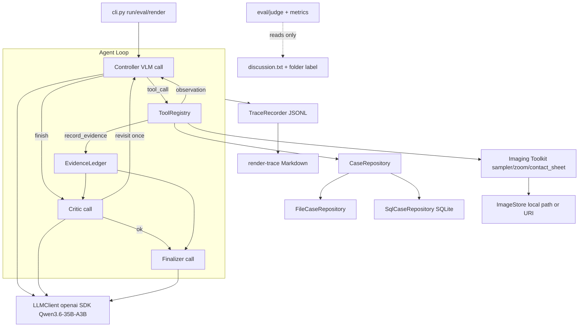
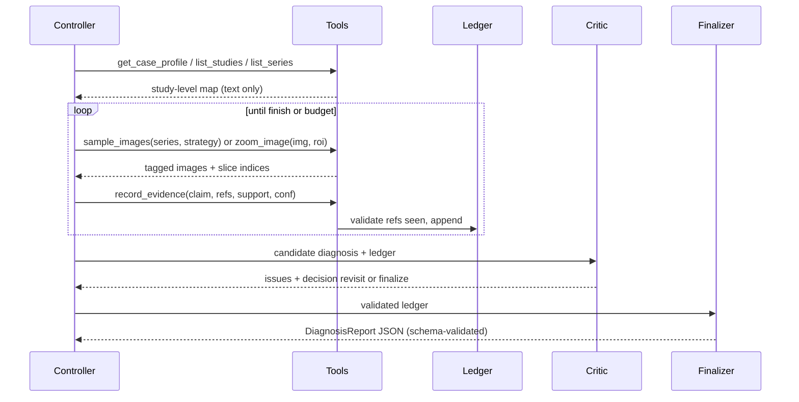

# 多模态医疗诊断 Agent 实施方案

> 已确认决策：`findings.md` 可见性 = 可配置开关，主线评测隐藏。
> 关键事实：端点仅暴露一个模型 `Qwen3.6-35B-A3B`（262k 上下文，多模态）

---

## 阶段一：需求与边界定义

### 1.1 任务定义

- 输入：一个匿名化病例 = 入院文本（`patient_data.txt`、`presentation.txt`）+ 若干检查（`study-*`，含模态、序列、图像）。
- 输出：结构化 `DiagnosisReport`（主诊断、鉴别诊断、关键发现 + 证据引用、不确定性、下一步建议检查、trace_id）+ 由其渲染的自然语言报告。
- 流程：入院信息 → 主动取证（选择检查/序列/图像、放大复查）→ 结构化观察 → 一致性校验 → 诊断。

### 1.2 范围

- 必做：VLM 驱动的 Agent；处理全部 11 类模态；可复现轨迹；一页说明 + 示例轨迹；10 个病例端到端跑通。
- 加分：SQL 兼容（同一 `CaseRepository` 接口的 SQLite 后端，表结构可迁移到 Postgres/MySQL）。
- 不做：任何训练；本地部署重型分割/分类模型（VILA-M3/MONAI 等作为"长期扩展"写入文档）；DICOM 解析；真实临床使用。

### 1.3 数据边界与标签泄漏控制（验收硬约束）

- 病例目录名即诊断标签（如 `appendiceal-intussusception-8`）→ 索引时映射为 `case-01..case-10`，Agent 只见匿名 id；图像以 `img:<image_id>` 引用，**绝不向模型暴露文件路径**。
- `discussion.txt` → 仅评估器读取，独立表/独立模块，Repository 不提供访问入口。
- `findings.md` → 多个病例几乎直接写出诊断（"consistent with an epiphrenic diverticulum"、"patent urachal tract"）。由 `--findings {hidden,visible}` 控制 `read_study_findings` 工具是否注册；默认 `hidden`。
- `image_urls.txt` → 不使用（离线，图像以 base64 data URL 发送）。
- 端点 URL / Key → 仅经环境变量 `OPENAI_BASE_URL` / `OPENAI_API_KEY` 读取；`.env` 入 `.gitignore`；轨迹和文档中不出现密钥。
- 特殊数据形态必须处理：CT 单序列最多 679 切片（512×512）；X-ray 最大 2304×2800；乳腺摄影为 55 张堆栈；`patent-urachus` 病例入院文本为空。


### 1.4 非功能约束与预算

- 每病例默认预算：≤ 14 次工具调用、≤ 24 张图像发送、≤ 1 轮 Critic 复查、单次 LLM 超时 120s、总超时 15 min。
- 可复现：`temperature=0`、固定 `seed`、记录 `model id` 与 `prompt_version`。
- 费用：轨迹记录每次调用 token 用量；目标每病例 ≤ 60k tokens（端点使用被监控）。


### 1.5 验收标准（可验证）

- 10 个病例在 `file` 与 `sqlite` 后端均端到端完成，且 `get_case_profile/list_studies/list_series` 返回逐字段一致。
- `finish()` 中每条 `key_finding` 的 `evidence_refs` 都存在于本次运行已查看的图像/文本集合中（由代码强制校验，不合法即拒绝）。
- 轨迹 JSONL 可用 `render-trace` 还原为可读 Markdown；泄漏测试：轨迹中不含 `discussion.txt` 任意句子和原始目录名。
- 评测报告包含 S1–S4 四种设置的准确率、证据覆盖率、无支持声明数、工具次数、token、延迟。

---


## 阶段二：架构与模式选型


### 2.1 模式

- 单控制器 ReAct 式工具循环，带显式阶段：Survey（病例地图）→ Hypothesize → Gather（取证）→ Record → Critic → Finalize。
- 角色分工用"不同 system prompt 的独立调用"实现，而非常驻多 Agent：Controller（含 Text/Modality Reader 职责）、Critic（只看证据账本）、Finalizer（只看校验后的账本）。
- 工具负责可验证事实（检索、排序、采样、裁剪、联系表、schema 校验、落盘）；VLM 负责分解问题、选工具、跨模态关联、鉴别诊断。


### 2.2 取舍说明

- 不用 LangGraph：端点 tool-calling 兼容性未知，自研 loop 便于降级与轨迹控制。


### 2.3 工具调用传输层（Day 1 冒烟后二选一，接口不变）

- 首选：OpenAI 原生 `tools=` function calling。
- 降级：JSON 动作协议——模型输出 `{"action": "<tool>", "args": {...}}`，pydantic 解析，失败回传错误重试一次。
- 适配器 `LLMClient.step(messages, tools) -> list[ToolCall] | FinalText` 屏蔽两者差异。


### 2.4 架构图




### 2.5 单病例执行流




---


## 阶段三：核心组件


### 3.1 仓库结构

```text
cair/
  cair_agent/
    config.py              # env、预算、策略开关 (findings policy, backend)
    data/index.py          # 扫描 data_subset10 -> CaseIndex，匿名化 case_id
    data/repository.py     # CaseRepository ABC / FileCaseRepository / SqlCaseRepository
    data/schema.sql        # SQLite 表
    data/build_sqlite.py   # CaseIndex -> cair.sqlite
    imaging/sampler.py     # anchors / uniform / neighbors 采样
    imaging/ops.py         # resize(max_side) / crop_zoom / contact_sheet / side_by_side
    imaging/encode.py      # PIL -> base64 data URL
    llm/client.py          # openai 客户端、重试、用量统计、tools 传输适配
    llm/schemas.py         # pydantic: ToolCall / Evidence / CriticResult / DiagnosisReport
    agent/tools.py         # 工具注册表：name、json schema、handler、expert card
    agent/ledger.py        # EvidenceLedger + 引用合法性校验
    agent/controller.py    # 主循环、预算、停止条件、上下文裁剪
    agent/critic.py / finalizer.py
    agent/prompts/*.md     # 版本化提示词
    trace/recorder.py      # JSONL 事件
    trace/render.py        # JSONL -> Markdown 示例轨迹
    eval/run_matrix.py / judge.py / metrics.py
    cli.py                 # index | build-db | run | eval | render-trace
  tests/                   # pytest
  scripts/smoke_vlm.py     # Day1 端点冒烟（图文 + tools 支持探测）
  runs/                    # 运行产物（gitignore 大文件）
  docs/one_pager.md  docs/example_trace.md  README.md
  pyproject.toml  requirements.txt  .env.example  .gitignore
```


### 3.2 数据层

- `CaseIndex` 由 `index.py` 一次性生成：遍历目录，解析 `series.json`，按文件名 `NNNN-<image_id>.ext` 得到 `slice_index` 与 `image_id`；`anchor_image_id` 与 `position` 对应校验（已验证：75312807 − 75312661 = 146 = position）。
- 核心模型（pydantic）：`CaseProfile(case_id, age, sex, presentation)`、`Study(study_id, case_id, modality, order)`、`Series(series_id, study_id, caption, count, anchor_slice)`、`Image(image_id, series_id, slice_index, uri, width, height)`。
- `CaseRepository` 接口：`get_case_profile(case_id)`、`list_studies(case_id)`、`list_series(study_id)`、`list_images(series_id)`、`get_findings(study_id)`（仅 policy=visible 时被工具层调用）、`resolve_image(image_id) -> bytes`。无任何 discussion 访问方法。
- SQLite 表：`patients、studies、series、images、reports(study_id, report_type='findings', text)`；评估专用 `eval_labels(case_id, label, discussion)` 由 `eval/` 直接连接读取，Repository 不引用该表。SQL 只读连接 (`?mode=ro`)、参数化、`LIMIT`、超时；每次查询写审计事件。


### 3.3 影像工具箱（确定性代码）

- 统一预处理：最长边 ≤ 1024（CT 512 原生不放大）、JPEG q=85；每张图像在消息中带文本标签 `[img:<id> | study-xxx ct | Axial C+ portal venous | slice 339/679]`。
- `sample_images(series_id, strategy, n)`：
  - `count==1` 或 `≤6` → 全部单图发送（X-ray、US、透视、照片、病理、标注/插图）。
  - 堆栈（CT/MRI/乳腺断层）→ `anchors`：anchor 切片单图全分辨率；`uniform`：等距 n 张（默认 8）拼成 4×2 联系表并标注切片号；`neighbors`：以某切片为中心 ±k。
- `zoom_image(image_id, roi=[x0,y0,x1,y1] 归一化, scale)`：局部裁剪放大，用于目标级复查。
- `compare_images(image_ids)`（P2）：并排拼图，支持多平面/随访对比。
- 标注图/插图/病理在标签中标明证据等级 `secondary`，提示模型不要混淆为原始影像。


### 3.4 工具契约（Agent 可见，共 8 个 + 1 个策略门控）

```text
get_case_profile(case_id)                       -> 年龄/性别/表现（可为空，标明 missing）
list_studies(case_id)                           -> [study_id, modality, n_series, order]
list_series(study_id)                           -> [series_id, caption, count, anchor_slice, grade]
read_study_findings(study_id)   [policy gated]  -> findings 文本
sample_images(series_id, strategy, n)           -> 带标签图像 + 返回 image_ids
zoom_image(image_id, roi, scale)                -> 放大图
compare_images(image_ids)       [P2]            -> 并排图
record_evidence(claim, source, refs, support, confidence, contradictions)
finish(diagnosis, differentials, key_findings, uncertainty, next_best_check)
```

- 每个工具附 `expert card`：适用模态、输入/输出字段、成本、失败条件，自动渲染进 system prompt。


### 3.5 证据账本与停止条件

- `Evidence` 结构沿用调研文档：`claim / source(patient_text|study_findings|image|tool) / evidence_refs[{study_id, series_id, image_id, slice_index}] / support(direct|indirect|absent) / confidence / contradictions`。
- 合法性：`refs` 必须属于本次运行已通过工具返回的 image_id 或文本块 id，否则拒绝并回传错误。
- 停止条件（按序检查）：模型调用 `finish` → 工具预算用尽 → 连续 2 轮无新增证据（先提示一次再强制）→ 任一触发均进入 Critic/Finalizer，不允许空结果退出。


### 3.6 Critic 与 Finalizer

- Critic 输入：候选诊断 + 账本（无图像）；输出 `CriticResult(issues[type: contradiction|unsupported|laterality|modality_mismatch|missing_key_study, detail], decision: finalize|revisit, suggested_tool_call?)`；最多 1 轮 `revisit`。
- Finalizer 输入：校验后账本 + Critic 结论；输出 `DiagnosisReport`（调研文档第 7 节格式）；pydantic 校验失败最多重试 2 次，仍失败则降级为"基于账本的模板报告"并在轨迹中标记。


### 3.7 轨迹（JSONL，每行一个事件）

- 事件类型：`case_start, llm_request(role, n_images, prompt_version), llm_response(tokens, latency), tool_call(name, args), tool_result(summary, image_ids), evidence_added, critic_result, finish, error, budget_exhausted, case_end(usage_total)`。
- 图像只记 `image_id`/切片号，不存 base64；`render-trace` 生成"病例地图 → 选检查 → 采样 → 观察 → 假设更新 → Critic → 诊断"的 Markdown，并把原始工具 IO 与最终答案分区展示。

---


## 阶段四：提示词与上下文工程


### 4.1 Controller system prompt 骨架（`prompts/controller.md`）

- 角色：放射科 + 临床综合诊断助手，仅凭可见材料推理。
- 流程指令：先调用 profile/list_studies/list_series 建病例地图 → 写出 2–3 个初始假设 → 优先采样与假设最相关的检查（堆栈先 anchor + uniform，再对可疑区域 zoom/neighbors）→ 每批图像后必须 `record_evidence` → 证据足够或预算将尽时 `finish`。
- 硬规则：只引用已看到的 `img:` / 文本；区分"观察到的事实"与"推断"；标注左右侧与解剖部位；文本缺失时写明 missing 并以影像为主；禁止凭模态/检查组合猜测"典型病"。
- 模态阅读提示（每类 1–2 句）：CT 相位/窗、MRI 序列含义（PD fat-sat、T2）、X-ray 视图（frontal/lateral/frog-leg/flexion-extension）、乳腺 CC/MLO、超声、病理放大倍数与 IHC、核医学摄取、标注图/插图为二级证据。


### 4.2 上下文分层与裁剪

- Study 级文本摘要（模态、序列、切片数、顺序）常驻上下文。
- 图像仅经工具结果进入；超过 K=3 轮前的图像部分替换为文本占位 `(img:xxx 已查看，观察已记录于账本)`，保留标签与观察，控制 token。
- 预算提示：每轮工具结果末尾附 `budget: 已用 6/14 调用, 10/24 图像`。


### 4.3 Critic prompt（`prompts/critic.md`）

- 对抗式清单：诊断是否有直接影像证据；是否存在矛盾证据；左右侧/部位/模态/时间顺序是否一致；是否遗漏了与主诉最相关的检查；鉴别诊断是否被证据排除。只能输出 `CriticResult` JSON。


### 4.4 Finalizer prompt（`prompts/finalizer.md`）

- 诊断必须为具体疾病实体名；≥2 个鉴别诊断且各带 why 与 confidence；每条 key_finding 带 refs；`uncertainty` 列出缺失检查/低置信观察；输出纯 JSON。


### 4.5 结构化输出与降级

- 原生 tools 可用时：`finish`/`record_evidence` 的参数即 JSON schema；否则使用 4.x 的 JSON 动作协议。
- 所有提示词文件带 `prompt_version` 头，轨迹记录版本；修改提示词后重跑并对比指标。

---


## 阶段五：测试与评测


### 5.1 单元/集成测试（pytest，`tests/`）

- 索引：10 病例、24 检查、11 模态、3762 图像；anchor 与 position 对应；匿名 id 不含原目录名。
- 采样：uniform 索引覆盖首尾、联系表尺寸与标签正确；`zoom` ROI 边界裁剪。
- 账本：拒绝未见过的 ref；`finish` schema 校验。
- 后端一致性：File vs SQLite 的 profile/studies/series/images 逐字段相等。
- 轨迹：不含 discussion 文本与目录名；可被 `render-trace` 解析。
- 传输适配：JSON 协议解析与错误回传。


### 5.2 Day 1 冒烟（`scripts/smoke_vlm.py`）

- 文本 + 1 张 CT 图 → 验证图像可识别；带 `tools=` 的最小调用 → 决定传输层；记录 token 用量基线。


### 5.3 评测矩阵（`eval/run_matrix.py`，每设置 × 10 病例）

- S1 单轮多模态：入院文本 + 预选 anchor 图像一次调用，findings 隐藏（baseline）。
- S2 主动取证：完整工具循环，无 Critic，findings 隐藏。
- S3 主动取证 + Critic（主线）。
- S4 S3 + findings 可见（参考上界，对照"有报告"场景）。
- S5 后端一致性：S3 在 sqlite 后端重跑，比较病例事实与诊断。


### 5.4 指标（`eval/metrics.py`）

- 诊断：top-1 匹配（LLM-judge 按 exact / compatible / wrong 三档，以目录名 + discussion 为参考，人工复核 10 例）；鉴别诊断命中（top-3）。
- 证据：证据覆盖率（关键发现 refs 是否落在含该发现的检查上）；无支持声明数；Critic 发现的问题数。
- 成本：工具调用次数、发送图像数、tokens、延迟、schema 失败/重试次数。
- 安全：泄漏检查通过率。
- 产物：`runs/<ts>/<setting>/<case>.jsonl` + `summary.md`。

---


## 阶段六：生产部署与运维

- 环境：`conda create -n cair python=3.11`；`pyproject.toml` + `requirements.txt`（openai、pydantic、Pillow、numpy、sqlalchemy、typer、tenacity、pytest）；可选 `Dockerfile`。
- 配置：全部走环境变量 / `.env`（`OPENAI_BASE_URL`、`OPENAI_API_KEY`、`CAIR_MODEL`、`CAIR_BACKEND`、`CAIR_FINDINGS_POLICY`、预算项）；`.env.example` 入库，`.env` 与 `runs/` 大文件 gitignore。
- CLI：`python -m cair_agent index`、`build-db`、`run --case case-01 --backend sqlite --findings hidden`、`eval --settings S1,S2,S3,S4`、`render-trace runs/.../case-01.jsonl`。
- SQL 生产路径：`SqlCaseRepository` 基于 SQLAlchemy Core，连接串替换即可切 Postgres/MySQL；只读数据库账号；参数化 + 白名单 + `LIMIT` + 超时；图像以 `uri` 列存储，`ImageStore` 解析本地路径或 HTTP/对象存储。
- 可靠性：429/5xx 指数退避重试；预算与超时兜底强制 Finalize；开发期工具结果按参数哈希缓存以省 token。
- 可观测：每次运行 JSONL 轨迹 + 用量汇总；结构化日志；SQL 审计事件。
- 安全与合规：输出附"研究用途、非临床诊断"声明；无 PHI；密钥不入库；轨迹脱敏。

---


## 主要风险与对策

- 端点不支持 `tools=` → JSON 动作协议降级，Day 1 决定。
- 大 CT 堆栈选错切片 → anchor + uniform + neighbors + 多平面复查；预算内允许 2 次 zoom。
- 模型编造证据引用 → `finish`/`record_evidence` 代码级拒绝未见 ref。
- 入院文本为空（patent-urachus 病例）→ 提示词显式处理 missing，以影像为主。
- 标签泄漏 → 匿名化 + 轨迹泄漏测试。
- 截止时间 → 先交 P0，同步申请延期完成 P1/P2。


## 假设

- 使用 conda 创建 Python 3.11 环境；若受限则代码保持 3.9 兼容。
- 图像以 base64 data URL 发送，`temperature=0`。

